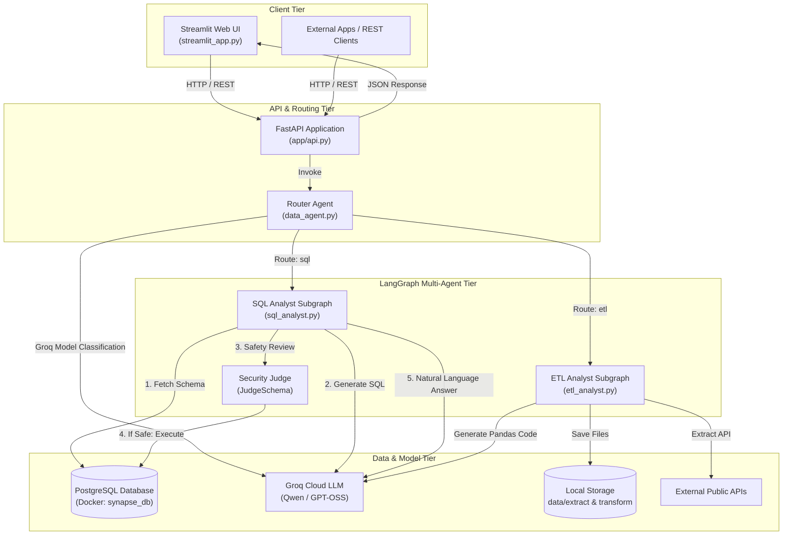
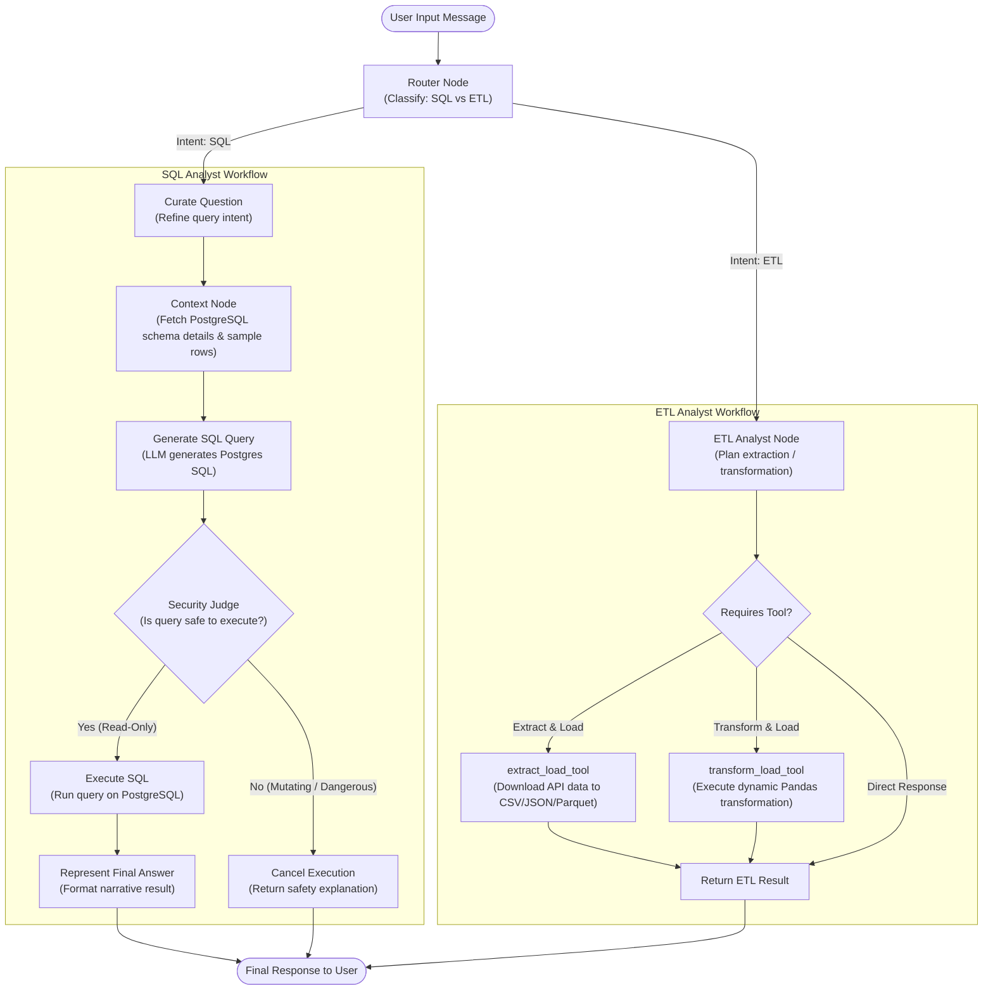
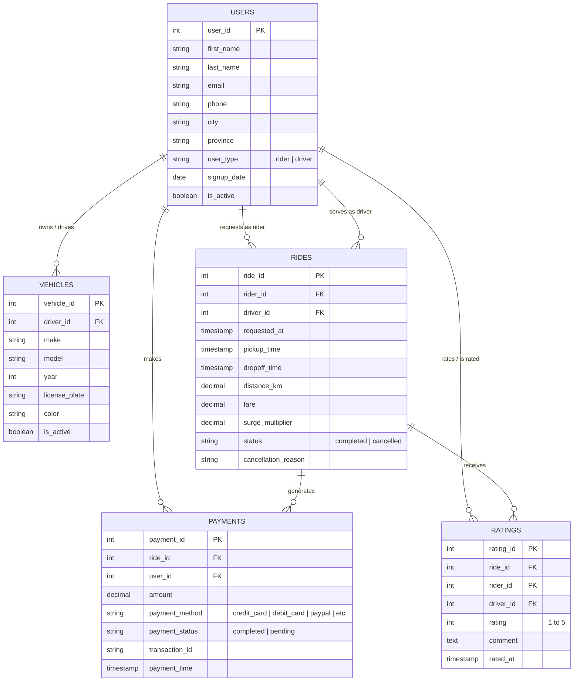
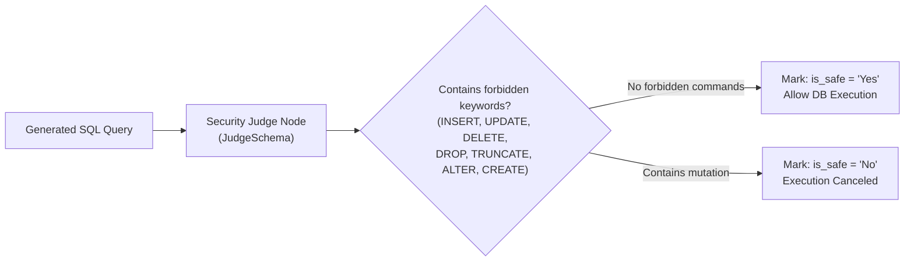

# 🧠 Synapse — Autonomous AI Data Platform

[](https://www.python.org/)
[](https://fastapi.tiangolo.com/)
[](https://streamlit.io/)
[](https://langchain-ai.github.io/langgraph/)
[](https://www.postgresql.org/)
[](https://groq.com/)

**Synapse** is an autonomous AI Data Platform that translates high-level natural language instructions into secure PostgreSQL database queries and automated ETL data processing workflows.

Built on **LangGraph**, **FastAPI**, **Streamlit**, and **Groq**, Synapse provides an intelligent multi-agent system that auto-classifies user intent, fetches dynamic database schema context, applies security guardrails, executes SQL queries, and builds data pipelines.

---

## 📑 Table of Contents

- [Overview](#-overview)
- [Key Features](#-key-features)
- [System Architecture](#-system-architecture)
  - [High-Level Architecture](#high-level-architecture)
  - [Agent Orchestration Workflow](#agent-orchestration-workflow)
  - [Query Execution Sequence](#query-execution-sequence)
- [Database Schema & ER Diagram](#-database-schema--er-diagram)
- [Project Structure](#-project-structure)
- [Prerequisites & Environment Setup](#-prerequisites--environment-setup)
- [Step-by-Step Installation](#-step-by-step-installation)
- [Running the Services](#-running-the-services)
- [API Reference](#-api-reference)
- [Example Queries & Capabilities](#-example-queries--capabilities)
- [Security & Guardrails](#-security--guardrails)
- [Tech Stack](#-tech-stack)

---

## 💡 Overview

Modern data analytics requires writing repetitive SQL queries, validating security policies, and constructing ad-hoc ETL scripts for external API data. 

**Synapse** solves this by providing:
1. **Intelligent Router**: Accurately classifies user requests into SQL database operations or ETL tasks.
2. **Safe SQL Analyst**: Converts natural language into PostgreSQL queries, evaluates query safety via an LLM judge, executes read queries safely on PostgreSQL, and formats human-friendly explanations.
3. **ETL Automation Analyst**: Ingests data from public REST APIs into formats such as CSV, JSON, or Parquet, and writes reproducible Pandas transformation scripts.
4. **Dual Interfaces**: An interactive **Streamlit** chat interface and a **FastAPI** REST backend.

---

## ✨ Key Features

- **Multi-Agent Orchestration with LangGraph**: StateGraph pipelines for agent routing, database inspection, and tool execution.
- **Built-in Security Guardrails**: An automated LLM Judge examines generated SQL queries before execution, blocking modifying commands (`INSERT`, `UPDATE`, `DELETE`, `DROP`, `TRUNCATE`, `ALTER`).
- **Dynamic Database Schema Reflection**: Extracts real-time schema information (tables, columns, data types, sample rows) to provide accurate database context to the LLM.
- **Automated ETL Pipeline**: Extracts API endpoints (e.g. PokeAPI, REST feeds) and executes Pandas transformations on target datasets.
- **Interactive Web Interface**: Streamlit UI with visual agent routing badges, collapsible SQL code inspection, execution logs, and live database schema viewer.
- **FastAPI REST API**: Fully documented endpoints with automatic OpenAPI/Swagger docs, CORS middleware, and health diagnostics.
- **Dockerized PostgreSQL Database**: Docker Compose setup for consistent local development.

---

## 🏛️ System Architecture

### High-Level Architecture



---

### Agent Orchestration Workflow



---

### Query Execution Sequence

```mermaid
sequenceDiagram
    autonumber
    actor User as User
    participant UI as Streamlit UI
    participant API as FastAPI Backend
    participant Agent as LangGraph Data Agent
    participant LLM as Groq LLM API
    participant DB as PostgreSQL DB

    User->>UI: Enter question: "How many users are in database?"
    UI->>API: POST /api/query {"question": "..."}
    API->>Agent: data_agent.invoke()
    Agent->>LLM: Classify intent (RouterSchema)
    LLM-->>Agent: route: "sql"
    Agent->>DB: Fetch public schema info & sample data
    DB-->>Agent: Tables, columns, sample rows
    Agent->>LLM: Generate Postgres SQL query
    LLM-->>Agent: "SELECT COUNT(*) FROM users;"
    Agent->>LLM: Evaluate SQL safety (JudgeSchema)
    LLM-->>Agent: answer: "Yes", comments: "Read-only query"
    Agent->>DB: Execute: "SELECT COUNT(*) FROM users;"
    DB-->>Agent: [(10000,)]
    Agent->>LLM: Format user-friendly narrative response
    LLM-->>Agent: "There are 10,000 users in the database."
    Agent-->>API: Return QueryResponse
    API-->>UI: 200 OK (answer, sql_query, is_safe, result)
    UI-->>User: Display answer, route badge, and expandable SQL
```

---

## 🗄️ Database Schema & ER Diagram

The database models a ride-sharing and payments system with 5 interconnected tables:



---

## 📁 Project Structure

```text
Synapse/
├── app/
│   ├── api.py                    # FastAPI application & REST endpoints
│   ├── config/
│   │   ├── __init__.py
│   │   └── config.py             # Pydantic Settings & environment loader
│   ├── src/
│   │   ├── agents/
│   │   │   ├── __init__.py
│   │   │   ├── data_agent.py     # Main router graph (DataAgentSchema)
│   │   │   ├── etl_analyst.py    # ETL analyst graph & tools
│   │   │   └── sql_analyst.py    # SQL analyst graph & security judge
│   │   ├── db/
│   │   │   ├── __init__.py
│   │   │   ├── database.py       # PostgreSQL database connection utility
│   │   │   └── feed_db.py        # Database migration & CSV seeding script
│   │   └── schema/
│   │       ├── __init__.py
│   │       └── schema.py         # Pydantic models & LangGraph schemas
│   └── utils/
│       ├── __init__.py
│       ├── etl_tools.py          # Extraction and Pandas execution helpers
│       ├── llm_pick.py           # Model selection utility (Groq Cloud)
│       └── logger.py             # Rotating daily logger setup
├── data/                         # Source CSV data files
│   ├── users.csv
│   ├── vehicles.csv
│   ├── rides.csv
│   ├── payments.csv
│   └── ratings.csv
├── docker-compose.yaml           # Dockerized PostgreSQL service definition
├── main.py                       # CLI test entrypoint
├── requirements.txt              # Project dependencies
├── setup.py                      # Package installation script
├── streamlit_app.py              # Streamlit interactive chat UI
└── README.md                     # Project documentation
```

---

## ⚙️ Prerequisites & Environment Setup

### 1. Prerequisites
- **Python**: Version 3.10, 3.11, or 3.12
- **Docker Desktop** (or a local PostgreSQL instance)
- **Groq API Key**: Create a free API key at [console.groq.com](https://console.groq.com/)

### 2. Environment Configuration

Create a `.env` file in the project root directory:

```env
# Groq Cloud API Key
GROQ_API_KEY=gsk_your_actual_groq_api_key_here

# PostgreSQL Database Configuration
PORT=5432
DATABASE=synapse_db
HOST=localhost
USER=admin
PASSWORD=admin
```

---

## 📦 Step-by-Step Installation

### Step 1: Clone the Repository
```bash
git clone https://github.com/your-username/Synapse.git
cd Synapse
```

### Step 2: Create and Activate Virtual Environment
```bash
# Windows (PowerShell)
python -m venv .venv
.\.venv\Scripts\Activate.ps1

# Linux / macOS
python3 -m venv .venv
source .venv/bin/activate
```

### Step 3: Install Dependencies
```bash
pip install -r requirements.txt
```

---

## 🚀 Running the Services

### 1. Start the PostgreSQL Database (Docker)
Start the database container using Docker Compose:
```bash
docker-compose up -d
```
*(Verify container status with `docker ps`)*

### 2. Seed the Database
Populate PostgreSQL with the provided initial CSV dataset:
```bash
python -m app.src.db.feed_db
```
This creates all tables, primary keys, foreign key constraints, indexes, and imports records into `users`, `vehicles`, `rides`, `payments`, and `ratings`.

### 3. Start the FastAPI Backend
```bash
uvicorn app.api:app --reload --port 8000
```
- **API Documentation (Swagger UI)**: [http://localhost:8000/docs](http://localhost:8000/docs)
- **Alternative ReDoc**: [http://localhost:8000/redoc](http://localhost:8000/redoc)
- **Health Check**: [http://localhost:8000/health](http://localhost:8000/health)

### 4. Start the Streamlit Web Application
In a separate terminal window:
```bash
streamlit run streamlit_app.py
```
The application will launch in your browser at:
👉 **[http://localhost:8501](http://localhost:8501)**

---

## 📡 API Reference

### Base URL: `http://localhost:8000`

### 1. Health Check
- **`GET /health`**
- **Response**:
```json
{
  "status": "healthy",
  "database_connected": true,
  "groq_api_key_configured": true
}
```

### 2. View Database Schema
- **`GET /api/schema`**
- **Response**: Returns the schema structure of all public tables, column data types, and sample data.

### 3. Unified Agent Query (SQL & ETL)
- **`POST /api/query`**
- **Request Body**:
```json
{
  "question": "What are the distinct payment methods available in the database?"
}
```
- **Response Body**:
```json
{
  "question": "What are the distinct payment methods available in the database?",
  "route": "sql",
  "answer": "The distinct payment methods are credit_card, debit_card, paypal, apple_pay, and google_pay.",
  "sql_query": "SELECT DISTINCT payment_method FROM payments LIMIT 10;",
  "sql_result": "[('credit_card',), ('debit_card',), ('paypal',), ('apple_pay',), ('google_pay',)]",
  "is_safe": "Yes",
  "comments": "The query is a read-only SELECT statement."
}
```

### 4. Direct SQL Analyst
- **`POST /api/sql`**
- **Request Body**: `{"question": "How many completed rides occurred?"}`

### 5. Direct ETL Analyst
- **`POST /api/etl`**
- **Request Body**: `{"question": "Extract pokemon data from https://pokeapi.co/api/v2/pokemon and save to data/extract as csv"}`

---

## 💬 Example Queries & Capabilities

| Intent | Query Example | Agent Triggered | Expected Action |
|---|---|---|---|
| **SQL** | *"What are the different types of Payment Methods in our database?"* | `SQL Analyst` | Generates `SELECT DISTINCT payment_method FROM payments`, verifies safety, executes, and lists methods. |
| **SQL** | *"How many active users are registered?"* | `SQL Analyst` | Executes `SELECT COUNT(*) FROM users WHERE is_active = true;` and provides total count. |
| **SQL** | *"Show top 5 rides with the highest fare amount."* | `SQL Analyst` | Generates query ordering by fare descending, limits to 5 rows, and summarizes findings. |
| **ETL** | *"Extract data from https://pokeapi.co/api/v2/pokemon and save it to data/extract as a CSV file."* | `ETL Analyst` | Invokes `extract_load_tool`, fetches API data, creates DataFrame, and writes to `data/extract/extracted_data.csv`. |
| **ETL** | *"Transform data/extract/extracted_data.csv to filter for bulbasaur and save as parquet in data/transform."* | `ETL Analyst` | Invokes `transform_load_tool`, writes Pandas filter code, executes, and writes output parquet file. |

---

## 🛡️ Security & Guardrails

To prevent data modification, prompt injections, or database corruption, Synapse enforces multi-layer security guardrails:



1. **Structured Safety Judge**: Every generated SQL query must pass through an LLM Judge node using strict Pydantic evaluation (`JudgeSchema`).
2. **Read-Only Whitelist**: Queries are restricted strictly to data retrieval (`SELECT`).
3. **Execution Cancellation**: If any query contains or implies data manipulation (`DROP`, `DELETE`, `UPDATE`, `INSERT`, `ALTER`, etc.), execution is aborted and a safety violation explanation is returned to the user.
4. **Row Limit Safeguard**: Queries default to a `LIMIT 10` safeguard unless explicitly instructed otherwise, preventing out-of-memory errors on massive tables.

---

## 🛠️ Tech Stack

| Technology | Purpose |
|---|---|
| **Python 3.12** | Core programming language |
| **FastAPI** | High-performance async REST API framework |
| **Streamlit** | Interactive UI for conversational analytics |
| **LangGraph / LangChain** | Agent orchestration, state machine graphs, and routing |
| **Groq Cloud Inference** | Low-latency inference (`qwen/qwen3.8-27b`, `openai/gpt-oss-20b`) |
| **PostgreSQL 17** | Relational database storage |
| **Psycopg2** | PostgreSQL adapter for Python |
| **Pandas / PyArrow** | Data processing, ETL transformations, and Parquet/CSV export |
| **Docker Compose** | Containerized database orchestration |

---

## 📄 License

This project is licensed under the MIT License. See [setup.py](setup.py) for package distribution details.
